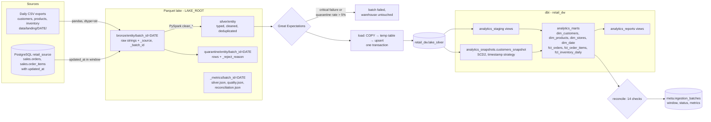
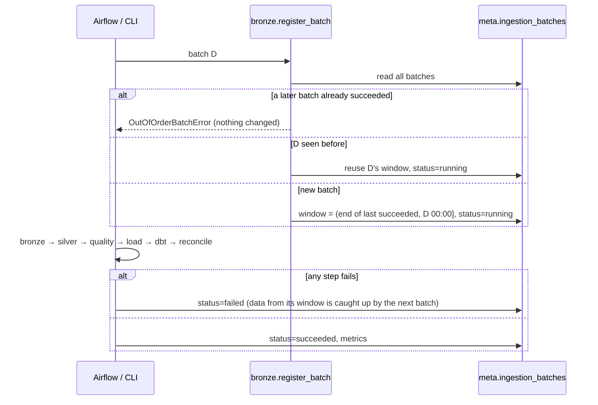
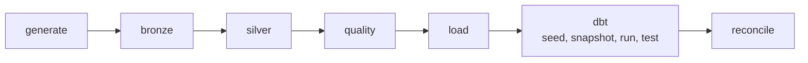
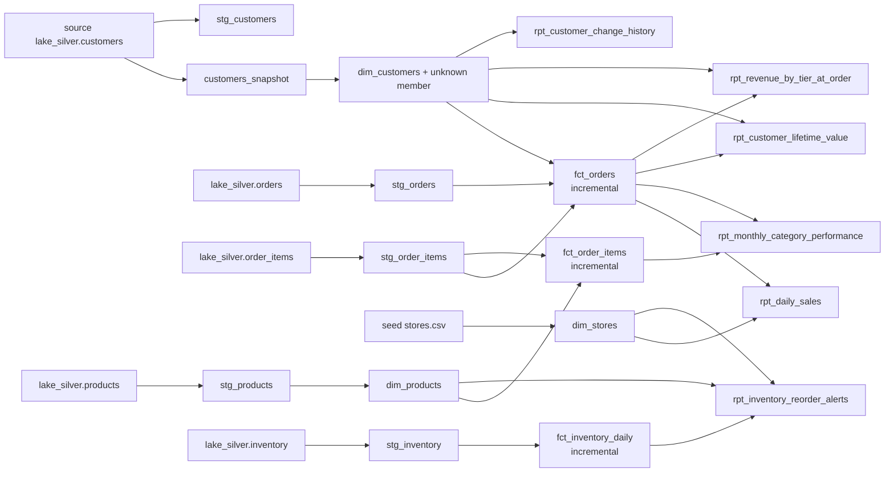
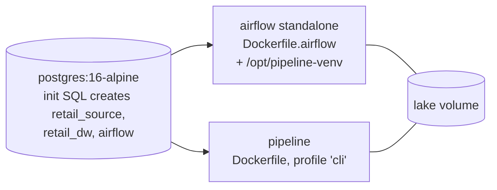

# Architecture

## Data flow

## Batch lifecycle and metadata

## Orchestration

- **DAG settings:** `airflow/dags/retail_lakehouse_dag.py` uses `schedule="@daily"`, `max_active_runs=1` (incremental windows must run in order), `catchup=False`, 1 retry, and a 30-minute task timeout.
- **How tasks run:** each task is a `BashOperator` that runs `python -m lakehouse.cli step <name> --batch-date {{ ds }}` in `PIPELINE_PYTHON`, a separate virtualenv. Airflow's constrained dependencies therefore never mix with PySpark, dbt or Great Expectations.
- **Failure signalling:** the CLI exits non-zero on failure, which marks the task failed.

## dbt model graph

## Deployment (Docker Compose)

