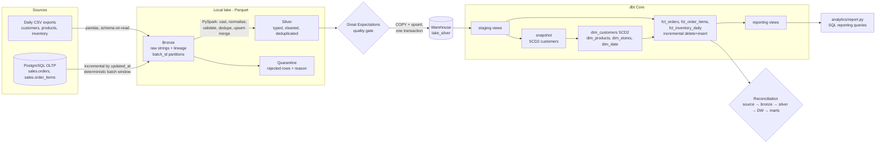
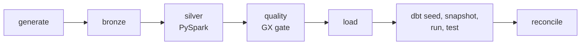

# Retail Data Lakehouse & Analytics Platform

An end-to-end batch data platform for a fictional retailer. Source data arrives as daily CSV exports and as rows in an operational PostgreSQL database. It lands in a **Bronze** layer, is cleaned and validated with **PySpark** into **Silver** Parquet, is gated by **Great Expectations**, loaded idempotently into a PostgreSQL warehouse, and modelled with **dbt** into an SCD Type 2 dimension, incremental facts and reporting views. **Airflow** orchestrates it, and reconciliation checks run at every layer boundary.

## Architecture



### Orchestration



Each Airflow task runs `python -m lakehouse.cli step <name> --batch-date {{ ds }}` in a dedicated pipeline virtualenv. Airflow's pinned dependencies therefore never conflict with PySpark, dbt or Great Expectations. `max_active_runs=1` keeps incremental windows in order.

## What each requirement maps to

| Requirement | Where |
|---|---|
| Synthetic customers, products, orders, order items, inventory | `lakehouse/generate.py`: deterministic replay per batch date; injects duplicates, bad emails, null keys, zero quantities, negative stock and casing noise |
| Ingest from CSV **and** PostgreSQL | `lakehouse/bronze.py`: `ingest_csv`, `ingest_postgres` |
| Bronze layer | `lake/bronze/<entity>/batch_id=YYYY-MM-DD/`, all columns stored as raw strings plus `_source` and `_batch_id` lineage columns |
| PySpark cleaning, schema enforcement, dedup | `lakehouse/silver.py`: explicit casts to `DecimalType(10,2)`, dates and timestamps; trim and case normalisation; status aliases; first-failing-rule quarantine; latest-`updated_at` dedup |
| Silver Parquet | `lake/silver/<entity>`. Orders are partitioned by `order_month`, inventory by `snapshot_date` |
| Load to PostgreSQL | `lakehouse/load.py`: snapshot entities are replaced; the rest go through COPY into a temp table, then `INSERT … ON CONFLICT DO UPDATE`, all in one transaction |
| dbt facts, dimensions, reports | `dbt/models/{staging,marts,reports}`: 4 dims, 3 incremental facts, 6 reports |
| Incremental + idempotent | Watermark windows stored in `meta.ingestion_batches`; Parquet upsert-merge that rewrites only touched partitions; dbt `delete+insert` incrementals. Re-runs are verified with content fingerprints (`lakehouse/fingerprint.py`) |
| SCD Type 2 | `dbt/snapshots/customers_snapshot.yml` (timestamp strategy on CRM `updated_at`) → `dim_customers`; `fct_orders` resolves `customer_sk` point-in-time |
| Airflow DAG | `airflow/dags/retail_lakehouse_dag.py` (Airflow 2/3 compatible imports) |
| Data quality + reconciliation | GX suites with critical vs warning severity and a quarantine-rate gate (`lakehouse/quality.py`); 38 dbt tests, including SCD2 overlap, revenue reconciliation and orders before store opening; 14 cross-layer reconciliation checks per batch (`lakehouse/reconcile.py`) |
| Dashboard / SQL reports | `analytics/queries/*.sql` + `python -m analytics.report` → `reports/analytics_report.md` |

## Quick start (local)

Requirements: Python 3.11/3.12, Java 17+ (for PySpark 4) and PostgreSQL 14+.

```bash
make install                         # .venv with PySpark, dbt-postgres, Great Expectations
cp .env.example .env                 # point SOURCE_DB_URL / WAREHOUSE_DB_URL at your server
make demo                            # init, then batches 2025-11-01..03, then re-run of 11-03
make report                          # writes reports/analytics_report.md
make run DATE=2025-11-04             # next daily batch
```

Single steps, as Airflow runs them:

```bash
.venv/bin/python -m lakehouse.cli step silver --batch-date 2025-11-04
```

## Docker

```bash
cp .env.example .env                 # set POSTGRES_PASSWORD
docker compose up --build -d postgres airflow      # Airflow UI: http://localhost:8080
docker compose --profile cli run --rm pipeline demo --days 3   # or run without Airflow
```

`docker/postgres-init.sql` creates the `retail_source`, `retail_dw` and `airflow` databases. Airflow runs in `standalone` mode, which is suitable for local demos, not production.

## Results from the local demo run

Three daily batches plus a re-run of the last one, on local PostgreSQL 16:

| Batch | Orders extracted (new + late updates) | Customers bronze → silver (dup / quarantined) | Order items quarantined | GX checks | Reconciliation |
|---|---|---|---|---|---|
| 2025-11-01 | 1,158 (full history) | 304 → 300 (2 / 2) | 1 | 23/23 | 14/14 |
| 2025-11-02 | 20 (16 new + 4 status changes) | 307 → 303 (2 / 2) | 1 | 23/23 | 14/14 |
| 2025-11-03 | 27 (23 new + 4 status changes) | 310 → 306 (2 / 2) | 1 | 23/23 | 14/14 |

- **Idempotency:** re-running batch 2025-11-03 left all nine warehouse tables content-identical (row count + MD5 over all rows).
- **SCD2:** `dim_customers` holds 330 versions for 306 customers. That is 24 changes across 23 customers.
- **dbt:** 38 tests, all passing.

Example analytics output (`reports/analytics_report.md`):

| completed_orders | revenue | avg_order_value | return_rate_pct | online_share_pct |
|---|---|---|---|---|
| 1071 | 1190327.50 | 1111.42 | 5.60 | 32.21 |

## Tests

```bash
make test                                   # 45 unit tests: PySpark transforms, merges, GX, generator, windows
TEST_PG_ADMIN_URL=postgresql://postgres:pw@localhost:5432/postgres make test-integration   # 8 end-to-end tests
make install-airflow && make test-dag       # 3 DAG integrity tests in an Airflow 3.3 env
```

The end-to-end suite builds throwaway databases and runs two batches through Spark, GX, PostgreSQL and dbt. It then checks:
- incremental extraction and late updates;
- quarantine reasons;
- SCD2 contiguity and point-in-time keys;
- that a re-run is idempotent;
- that a corrupted CSV (20% bad emails) trips the quality gate, marks the batch `failed` and leaves the warehouse unchanged.

## Design notes and trade-offs

- **Silver is plain Parquet, not Delta or Iceberg.** Merges stage the output and then swap partition directories, which works on a local or mounted filesystem. On object storage, the same upsert semantics should use Delta Lake or Apache Iceberg `MERGE`.
- **Spark runs in `local[*]` mode.** The data volume fits a laptop; the transforms are pure DataFrame functions and do not depend on local mode.
- **Snapshot entities are replaced in full**, matching how CRM exports usually arrive. History comes from the dbt snapshot rather than from the lake.
- **Dimensions are at day grain** for the point-in-time join. A customer change and an order on the same day attribute the order to the new version.

## Limitations

- **Docker and CI not run.** The Docker images, Compose stack and GitHub Actions workflow were written but not executed here (Docker was unavailable). Every pipeline step was run locally against native PostgreSQL 16, and the DAG was executed with `airflow dags test` on Airflow 3.3.2.
- **Single-node PostgreSQL** holds both the source and the warehouse. Credentials are plain environment variables; use a secrets backend in production.
- **No BI tool is bundled.** Reporting is done with SQL queries and a generated Markdown report.
- **All data is synthetic.**
