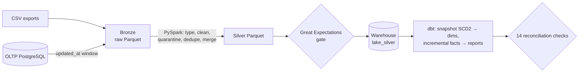

# Retail Data Lakehouse & Analytics Platform

[](https://github.com/Dileep5/retail-data-lakehouse/actions/workflows/ci.yml)

A batch data platform for a fictional retailer. Daily CSV exports and an operational PostgreSQL database feed a **Bronze → Silver** Parquet lake built with **PySpark**. A **Great Expectations** quality gate checks each batch before an idempotent load into a PostgreSQL warehouse. **dbt** then builds an SCD Type 2 customer dimension, incremental facts that handle late-arriving data, and reporting views. **Airflow** orchestrates the pipeline, and 14 reconciliation checks run per batch.



**Try it:** [DEMO.md](DEMO.md) · More detail: [ARCHITECTURE.md](ARCHITECTURE.md) · [IMPLEMENTATION_DETAILS.md](IMPLEMENTATION_DETAILS.md) · [TEST_RESULTS.md](TEST_RESULTS.md) · [TROUBLESHOOTING.md](TROUBLESHOOTING.md) · [INTERVIEW_GUIDE.md](INTERVIEW_GUIDE.md)

## Highlights (measured; see TEST_RESULTS.md)

- **Idempotent re-runs.** Re-running a batch leaves all 9 warehouse tables content-identical (row count + MD5 over all rows). Re-running an *older* batch is refused, because it would roll back the snapshot tables.
- **Incremental by design.**
  - **Extraction:** deterministic `updated_at` windows recorded per batch; late status changes are picked up.
  - **Silver:** Parquet upsert-merge rewrites only the touched partitions.
  - **dbt:** `delete+insert` incremental facts.
- **Late-arriving data.**
  - **Late line items:** they trigger recomputation of their earlier order.
  - **Late customers:** their orders map to an unknown member and are re-attributed point-in-time when the CRM record arrives. This was verified across batches, including one run by Airflow.
- **Quality and recovery.**
  - **Silver:** quarantine with a reason per rejected row.
  - **Quality gate:** critical and warning expectations plus a 5% quarantine-rate gate, all *before* loading. A corrupted batch fails without touching the warehouse.
  - **Recovery:** re-running the same date after the source is fixed succeeds, and failed windows are caught up by the next batch.
- **Verified:**
  - 59 pytest tests and 40 dbt tests pass, with 14/14 reconciliation checks per batch;
  - the Airflow DAG executed end to end with `airflow dags test`;
  - a fresh clone runs end to end using only the documented commands.

## Prerequisites

- Python 3.11 or 3.12
- Java 17+ (PySpark 4)
- PostgreSQL 14+ (local), **or** Docker with Compose
- No API keys needed

## Run locally

```bash
git clone <repo-url> retail-data-lakehouse && cd retail-data-lakehouse
make install                       # .venv: PySpark, dbt-postgres, Great Expectations
cp .env.example .env               # set SOURCE_DB_URL and WAREHOUSE_DB_URL (databases are created)
export JAVA_HOME=/path/to/jdk-17   # if java isn't already on PATH
make demo                          # batches 2025-11-01..03, then an idempotent re-run of 11-03
                                   # (on a non-empty warehouse run `make reset` first)
make report                        # reports/analytics_report.md from analytics/queries/*.sql
make run DATE=2025-11-04           # next daily batch
```

Single steps, exactly as Airflow runs them:

```bash
.venv/bin/python -m lakehouse.cli step silver --batch-date 2025-11-04
```

**Clean up:** `rm -rf lake data/landing reports`, then drop the two databases (`dropdb retail_source; dropdb retail_dw`).

### Airflow locally

```bash
make install-airflow                                   # separate .venv-airflow with official constraints
export AIRFLOW_HOME=$PWD/.airflow AIRFLOW__CORE__DAGS_FOLDER=$PWD/airflow/dags AIRFLOW__CORE__LOAD_EXAMPLES=False
export PIPELINE_PYTHON=$PWD/.venv/bin/python LAKEHOUSE_PROJECT_DIR=$PWD    # plus .env values exported
.venv-airflow/bin/airflow db migrate
.venv-airflow/bin/airflow dags test retail_lakehouse 2025-11-04
```

## Run with Docker

```bash
cp .env.example .env                                         # set POSTGRES_PASSWORD
docker compose up --build -d postgres airflow                # Airflow UI: http://localhost:8080
docker compose --profile cli run --rm pipeline demo --days 3 # run without Airflow
docker compose down                                          # stop
docker compose down -v                                       # stop and delete DB + lake volumes
```

> Docker was **not executed** during development; it was unavailable. The image tags and Linux dependency resolution were verified instead. See TEST_RESULTS.md.

## Sample input → expected output

**Input:** `data/landing/2025-11-02/customers.csv` (generated deterministically) contains realistic defects:

```
customer_id,first_name,last_name,email,city,province,loyalty_tier,signup_date,updated_at
85,Ethan,Anderson,  ETHAN.ANDERSON.85@EXAMPLE.COM ,Vancouver,BC,Silver,2023-02-20,2023-02-20 09:00:00
92,Mia,Taylor,mia.taylor.92@example.com,Halifax,ns,Silver,2024-01-05,2024-01-05 09:00:00
900001,...,not-an-email,...                       <- invalid row
,Mohammed,Taylor,mohammed.taylor.2@example.com,...  <- missing key
```

**Output of batch 2025-11-02:**

| Layer | Result |
|---|---|
| Silver | customer 85 → `ethan.anderson.85@example.com`; customer 92 → province `NS`; 2 exact duplicates removed |
| Quarantine | `invalid_email` (id 900001), `missing_customer_id` |
| Orders | 21 extracted: 16 new, 4 late status changes (completed → returned), 1 order from a customer whose CRM record only arrives in tomorrow's export |
| `dim_customers` | customer 1: v1 `Gold` valid 2025-07-09 → 2025-11-01 09:30, v2 `Silver` current |
| Quality gate | **22/23 passed, 0 critical failures** (see below) |
| Reconciliation | 14/14 |

### Why the quality report says 22/23

From the second batch onward the generator deliberately includes one **late-arriving customer**: an order arrives today, but the customer's CRM row only appears in tomorrow's export. The expectation `orders.customer_id ∈ Silver customers` is configured with severity **warning** (`lakehouse/quality.py:suites`), so it reports that one row (`unexpected_count: 1`) without blocking the batch. Only *critical* failures or a quarantine rate above 5% stop a batch.

The order is attributed to the unknown customer (`customer_sk = '-1'`, `customer_resolution = 'unknown'`) and re-attributed point-in-time by the next batch. The dbt test `assert_unknown_customer_orders_are_recent` fails if any order stays unresolved for more than 2 days. Batch 1 shows 23/23 because it contains no late customer.

## Example analytics (from `make report`, after batches 2025-11-01..04)

| completed_orders | revenue | avg_order_value | return_rate_pct | online_share_pct |
|---|---|---|---|---|
| 1091 | 1209632.34 | 1108.74 | 5.80 | 32.26 |

Seven SQL reports live in `analytics/queries/`: KPI summary, monthly revenue by region, category margin, top customers, revenue by loyalty tier *at the time of order* (SCD2), reorder alerts and the pipeline batch log. The dbt models in `analytics_reports.*` can be queried directly.

## Tests

```bash
make lint
make test                                                    # 45 unit tests (PySpark, GX, merges, generator)
TEST_PG_ADMIN_URL=postgresql://postgres:pw@localhost:5432/postgres make test-integration   # 11 end-to-end
make test-dag                                                # 3 DAG tests (needs make install-airflow)
```

**Where the results come from:**
- **Local runs** (macOS, PostgreSQL 16, Java 17) produced the exact counts quoted in this README: 59 pytest tests, 40 dbt tests, 14 reconciliation checks per batch, and the `airflow dags test` execution.
- **GitHub Actions** runs two jobs on every push:
  - `pipeline`: lint, dependency checks, unit tests, end-to-end tests against a PostgreSQL service, and `dbt parse`;
  - `airflow-dag`: the DAG integrity tests on Airflow 3.3.2.
- **First CI run:** [41555834547](https://github.com/Dileep5/retail-data-lakehouse/actions/runs/41555834547) on commit `8abca04` passed both jobs. CI test counts are in the run logs and are not restated here.

The end-to-end suite creates throwaway databases and runs 3 batches through Spark, GX, PostgreSQL and dbt. It asserts:
- incremental extraction and late status changes;
- late line items and late-customer re-attribution;
- quarantine reasons;
- SCD2 contiguity;
- idempotent re-runs;
- out-of-order refusal;
- the quality-gate failure, then recovery.

## Project layout

```
lakehouse/   generate.py  bronze.py  silver.py (PySpark)  merge.py  quality.py (GX)  load.py
             dbt_runner.py  reconcile.py  pipeline.py  cli.py  fingerprint.py  config.py  spark.py
dbt/         models/{staging,marts,reports}  snapshots/  seeds/stores.csv  tests/  macros/
airflow/dags/retail_lakehouse_dag.py
analytics/   queries/*.sql  report.py
sql/         source_schema.sql  warehouse_init.sql
tests/       unit/  integration/  airflow/
```

## Limitations

- **Plain Parquet, not Delta/Iceberg.** Merges swap directories and assume a single writer.
- **Backfills need a rebuild.** Re-running older batches is refused.
- **Small and local.** Spark runs locally; the reconciliation and GX checks use pandas.
- **Not executed:** Docker / Docker Compose (the images were never built) and the full Airflow scheduler/UI (`airflow standalone`). The DAG was executed with `airflow dags test`, and the test suite runs in GitHub Actions.
- **Unfixed advisory:** `sqlparse` advisories can't be fixed until dbt-core relaxes its pin; see TROUBLESHOOTING.md.

## License

MIT. See [LICENSE](LICENSE).
